<!-- ════════════════════════════════════════════════════════════
     UNIT RECORD : al-dioooo
     FORMAT      : NieR graph-paper UI
     ════════════════════════════════════════════════════════════ -->

  <picture>
    <source media="(prefers-color-scheme: dark)" srcset="banner-dark.svg" />
    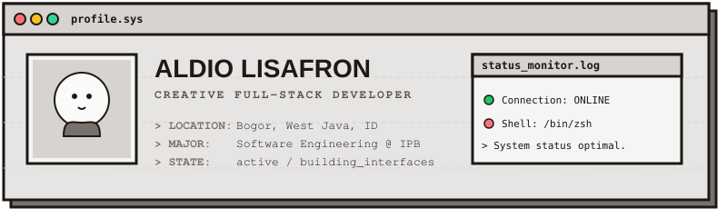
  </picture>

> **POD 042:** Report — unit `al-dioooo` operating within normal parameters.
> Primary directive: build systems that are useful, and keep them standing under pressure.
> Proposal: review the mission records below.

  <a href="https://al.is-a.dev/contact">
    <picture>
      <source media="(prefers-color-scheme: dark)" srcset="https://al.is-a.dev/api/readme/contact?theme=dark" />
      
    </picture>
  </a>

## <samp>■ 01 · MISSIONS // selected_work</samp>

  <a href="https://aksesin.onefatir.dev"><picture><source media="(prefers-color-scheme: dark)" srcset="assets/missions/aksesin-dark.svg" />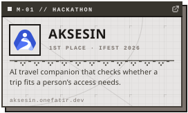</picture></a>
  <a href="https://al.is-a.dev/work/modular-erp"><picture><source media="(prefers-color-scheme: dark)" srcset="assets/missions/modular-erp-dark.svg" />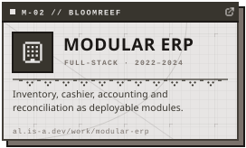</picture></a>
  <a href="https://gdgocipb.com"><picture><source media="(prefers-color-scheme: dark)" srcset="assets/missions/gdgoc-ipb-dark.svg" />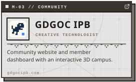</picture></a>

## <samp>■ 02 · LOADOUT // stack_and_tools</samp>

  <picture><source media="(prefers-color-scheme: dark)" srcset="assets/loadout/php-dark.svg" />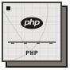</picture>
  <picture><source media="(prefers-color-scheme: dark)" srcset="assets/loadout/javascript-dark.svg" />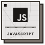</picture>
  <picture><source media="(prefers-color-scheme: dark)" srcset="assets/loadout/typescript-dark.svg" />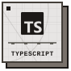</picture>
  <picture><source media="(prefers-color-scheme: dark)" srcset="assets/loadout/html-dark.svg" />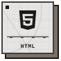</picture>
  <picture><source media="(prefers-color-scheme: dark)" srcset="assets/loadout/css-dark.svg" />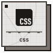</picture>
   
  <picture><source media="(prefers-color-scheme: dark)" srcset="assets/loadout/laravel-dark.svg" />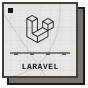</picture>
  <picture><source media="(prefers-color-scheme: dark)" srcset="assets/loadout/react-dark.svg" />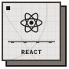</picture>
  <picture><source media="(prefers-color-scheme: dark)" srcset="assets/loadout/nextjs-dark.svg" />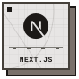</picture>
  <picture><source media="(prefers-color-scheme: dark)" srcset="assets/loadout/vue-dark.svg" />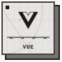</picture>
  <picture><source media="(prefers-color-scheme: dark)" srcset="assets/loadout/inertia-dark.svg" />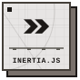</picture>
  <picture><source media="(prefers-color-scheme: dark)" srcset="assets/loadout/tailwindcss-dark.svg" />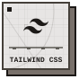</picture>
   
  <picture><source media="(prefers-color-scheme: dark)" srcset="assets/loadout/react-native-dark.svg" />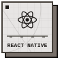</picture>
  <picture><source media="(prefers-color-scheme: dark)" srcset="assets/loadout/expo-dark.svg" />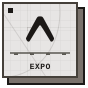</picture>
  <picture><source media="(prefers-color-scheme: dark)" srcset="assets/loadout/fastify-dark.svg" />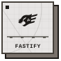</picture>
  <picture><source media="(prefers-color-scheme: dark)" srcset="assets/loadout/drizzle-dark.svg" />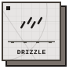</picture>
  <picture><source media="(prefers-color-scheme: dark)" srcset="assets/loadout/mysql-dark.svg" />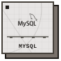</picture>
  <picture><source media="(prefers-color-scheme: dark)" srcset="assets/loadout/postgresql-dark.svg" />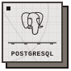</picture>
   
  <picture><source media="(prefers-color-scheme: dark)" srcset="assets/loadout/figma-dark.svg" />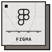</picture>
  <picture><source media="(prefers-color-scheme: dark)" srcset="assets/loadout/canva-dark.svg" />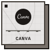</picture>
  <picture><source media="(prefers-color-scheme: dark)" srcset="assets/loadout/threejs-dark.svg" />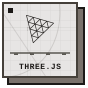</picture>
  <picture><source media="(prefers-color-scheme: dark)" srcset="assets/loadout/webgl-dark.svg" />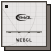</picture>
  <picture><source media="(prefers-color-scheme: dark)" srcset="assets/loadout/git-dark.svg" />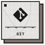</picture>
  <picture><source media="(prefers-color-scheme: dark)" srcset="assets/loadout/github-dark.svg" />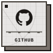</picture>

## <samp>■ 03 · COMMS // transmission_channels</samp>

  <a href="https://al.is-a.dev"><picture><source media="(prefers-color-scheme: dark)" srcset="assets/comms/website-dark.svg" />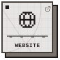</picture></a>
  <a href="https://linkedin.com/in/aldio-lisafron"><picture><source media="(prefers-color-scheme: dark)" srcset="assets/comms/linkedin-dark.svg" /></picture></a>
  <a href="https://instagram.com/al.dioooo"><picture><source media="(prefers-color-scheme: dark)" srcset="assets/comms/instagram-dark.svg" /></picture></a>
  <a href="mailto:contact@al.is-a.dev"><picture><source media="(prefers-color-scheme: dark)" srcset="assets/comms/email-dark.svg" />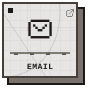</picture></a>

<!-- [E]ject data? ... negative. Thanks for reading. -->
