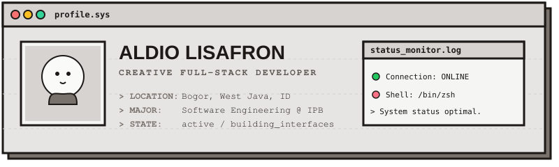
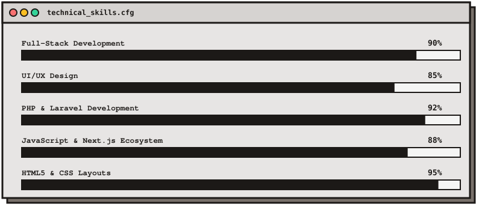
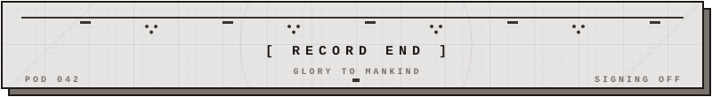

<!-- ════════════════════════════════════════════════════════════
     UNIT RECORD : al-dioooo
     FORMAT      : NieR graph-paper UI
     ════════════════════════════════════════════════════════════ -->

  

  <samp><b>Full-stack developer working across secure systems, applied AI, and maintainable code.</b></samp>

  

> <samp><b>POD 042:</b> Report — unit <code>al-dioooo</code> operating within normal parameters.
> Primary directive: build systems that are useful, and keep them standing under pressure.
> Proposal: review the records below.</samp>

## <samp>■ 01 · INTEL // unit_data</samp>

I build web applications that turn everyday workflows into structured, usable tools. My foundation is PHP/Laravel, JavaScript, and database-backed features — the unglamorous work of making software people can actually rely on.

Lately my attention has moved a layer deeper: how those systems hold up when someone is actively trying to break them, and where an AI model earns its place in a product instead of just decorating it. Security engineering and applied AI are where my learning hours go now — built on top of the web work rather than replacing it.

I like products with a clear real-world purpose: business systems, information dashboards, educational resources, and tools that help people manage data with less friction.

  

## <samp>■ 02 · INTEL // points_of_interest</samp>

- **Cyber security** — secure-by-default design, threat modeling, hardening real systems
- **AI integration** — putting models into products where they do actual work
- **AI model engineering** — fine-tuning, evaluation, production-ready models
- **Practical web systems** — the foundation the above gets built on

  

## <samp>■ 03 · SKILLS // loadout</samp>

  

  

## <samp>■ 04 · COMMS // transmission_channels</samp>

  &nbsp;
  
   
  &nbsp;
  

  

<!-- [E]ject data? ... negative. Thanks for reading. -->
