<!-- ════════════════════════════════════════════════════════════
     UNIT RECORD : al-dioooo
     FORMAT      : NieR graph-paper UI
     Drawn by scripts/render.mjs from scripts/data/profile.mjs.
     Edit the data or the script, then run: node scripts/render.mjs
     ════════════════════════════════════════════════════════════ -->

<a href="https://al.is-a.dev"><picture><source media="(prefers-color-scheme: dark) and (min-width: 1012px)" srcset="assets/svg/hero-dark.svg" /><source media="(prefers-color-scheme: light) and (min-width: 1012px)" srcset="assets/svg/hero-light.svg" /><source media="(prefers-color-scheme: dark)" srcset="assets/svg/hero-dark-mobile.svg" /></picture></a>

  <a href="https://al.is-a.dev/contact">
    <picture>
      <source media="(prefers-color-scheme: dark) and (min-width: 1012px)" srcset="https://al.is-a.dev/api/readme/contact?theme=dark" />
      <source media="(prefers-color-scheme: light) and (min-width: 1012px)" srcset="https://al.is-a.dev/api/readme/contact" />
      <source media="(prefers-color-scheme: dark)" srcset="https://al.is-a.dev/api/readme/contact?theme=dark&amp;view=mobile" />
      
    </picture>
  </a>

<picture><source media="(prefers-color-scheme: dark) and (min-width: 1012px)" srcset="assets/svg/stats-dark.svg" /><source media="(prefers-color-scheme: light) and (min-width: 1012px)" srcset="assets/svg/stats-light.svg" /><source media="(prefers-color-scheme: dark)" srcset="assets/svg/stats-dark-mobile.svg" /></picture>

<picture><source media="(prefers-color-scheme: dark) and (min-width: 1012px)" srcset="assets/svg/header-service-dark.svg" /><source media="(prefers-color-scheme: light) and (min-width: 1012px)" srcset="assets/svg/header-service-light.svg" /><source media="(prefers-color-scheme: dark)" srcset="assets/svg/header-service-dark-mobile.svg" /></picture>

<picture><source media="(prefers-color-scheme: dark) and (min-width: 1012px)" srcset="assets/svg/experience-dark.svg" /><source media="(prefers-color-scheme: light) and (min-width: 1012px)" srcset="assets/svg/experience-light.svg" /><source media="(prefers-color-scheme: dark)" srcset="assets/svg/experience-dark-mobile.svg" /></picture>

<picture><source media="(prefers-color-scheme: dark) and (min-width: 1012px)" srcset="assets/svg/header-missions-dark.svg" /><source media="(prefers-color-scheme: light) and (min-width: 1012px)" srcset="assets/svg/header-missions-light.svg" /><source media="(prefers-color-scheme: dark)" srcset="assets/svg/header-missions-dark-mobile.svg" /></picture>

<a href="https://aksesin.onefatir.dev"><picture><source media="(prefers-color-scheme: dark)" srcset="assets/svg/mission-aksesin-dark.svg" /></picture></a>
<a href="https://al.is-a.dev/work/modular-erp"><picture><source media="(prefers-color-scheme: dark)" srcset="assets/svg/mission-modular-erp-dark.svg" /></picture></a>
<a href="https://gdgocipb.com"><picture><source media="(prefers-color-scheme: dark)" srcset="assets/svg/mission-gdgoc-ipb-dark.svg" /></picture></a>
<a href="https://lokerin.site"><picture><source media="(prefers-color-scheme: dark)" srcset="assets/svg/mission-lokerin-dark.svg" /></picture></a>
<a href="https://al.is-a.dev/work/siren"><picture><source media="(prefers-color-scheme: dark)" srcset="assets/svg/mission-siren-dark.svg" /></picture></a>
<a href="https://yorhagarden.xyz"><picture><source media="(prefers-color-scheme: dark)" srcset="assets/svg/mission-yorha-garden-dark.svg" /></picture></a>

<a href="https://al.is-a.dev/work"><picture><source media="(prefers-color-scheme: dark)" srcset="assets/svg/cta-missions-dark.svg" /></picture></a>

<picture><source media="(prefers-color-scheme: dark) and (min-width: 1012px)" srcset="assets/svg/header-loadout-dark.svg" /><source media="(prefers-color-scheme: light) and (min-width: 1012px)" srcset="assets/svg/header-loadout-light.svg" /><source media="(prefers-color-scheme: dark)" srcset="assets/svg/header-loadout-dark-mobile.svg" /></picture>

<picture><source media="(prefers-color-scheme: dark) and (min-width: 1012px)" srcset="assets/svg/loadout-dark.svg" /><source media="(prefers-color-scheme: light) and (min-width: 1012px)" srcset="assets/svg/loadout-light.svg" /><source media="(prefers-color-scheme: dark)" srcset="assets/svg/loadout-dark-mobile.svg" /></picture>

<picture><source media="(prefers-color-scheme: dark) and (min-width: 1012px)" srcset="assets/svg/header-signal-dark.svg" /><source media="(prefers-color-scheme: light) and (min-width: 1012px)" srcset="assets/svg/header-signal-light.svg" /><source media="(prefers-color-scheme: dark)" srcset="assets/svg/header-signal-dark-mobile.svg" /></picture>

<a href="https://github.com/al-dioooo"><picture><source media="(prefers-color-scheme: dark) and (min-width: 1012px)" srcset="https://raw.githubusercontent.com/al-dioooo/al-dioooo/output/signal-dark.svg" /><source media="(prefers-color-scheme: light) and (min-width: 1012px)" srcset="https://raw.githubusercontent.com/al-dioooo/al-dioooo/output/signal-light.svg" /><source media="(prefers-color-scheme: dark)" srcset="https://raw.githubusercontent.com/al-dioooo/al-dioooo/output/signal-dark-mobile.svg" /></picture></a>

<picture><source media="(prefers-color-scheme: dark) and (min-width: 1012px)" srcset="assets/svg/header-training-dark.svg" /><source media="(prefers-color-scheme: light) and (min-width: 1012px)" srcset="assets/svg/header-training-light.svg" /><source media="(prefers-color-scheme: dark)" srcset="assets/svg/header-training-dark-mobile.svg" /></picture>

<picture><source media="(prefers-color-scheme: dark) and (min-width: 1012px)" srcset="assets/svg/training-dark.svg" /><source media="(prefers-color-scheme: light) and (min-width: 1012px)" srcset="assets/svg/training-light.svg" /><source media="(prefers-color-scheme: dark)" srcset="assets/svg/training-dark-mobile.svg" /></picture>

<picture><source media="(prefers-color-scheme: dark) and (min-width: 1012px)" srcset="assets/svg/header-comms-dark.svg" /><source media="(prefers-color-scheme: light) and (min-width: 1012px)" srcset="assets/svg/header-comms-light.svg" /><source media="(prefers-color-scheme: dark)" srcset="assets/svg/header-comms-dark-mobile.svg" /></picture>

<a href="https://al.is-a.dev"><picture><source media="(prefers-color-scheme: dark)" srcset="assets/svg/comm-website-dark.svg" /></picture></a>
<a href="https://linkedin.com/in/aldio-lisafron"><picture><source media="(prefers-color-scheme: dark)" srcset="assets/svg/comm-linkedin-dark.svg" /></picture></a>
<a href="https://instagram.com/al.dioooo"><picture><source media="(prefers-color-scheme: dark)" srcset="assets/svg/comm-instagram-dark.svg" /></picture></a>
<a href="mailto:contact@al.is-a.dev"><picture><source media="(prefers-color-scheme: dark)" srcset="assets/svg/comm-email-dark.svg" /></picture></a>

<picture><source media="(prefers-color-scheme: dark) and (min-width: 1012px)" srcset="assets/svg/footer-dark.svg" /><source media="(prefers-color-scheme: light) and (min-width: 1012px)" srcset="assets/svg/footer-light.svg" /><source media="(prefers-color-scheme: dark)" srcset="assets/svg/footer-dark-mobile.svg" /></picture>

<!-- [E]ject data? ... negative. Thanks for reading. -->
